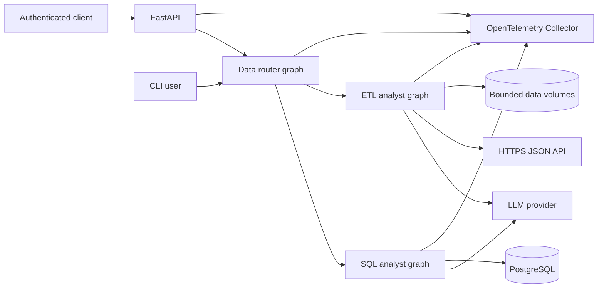
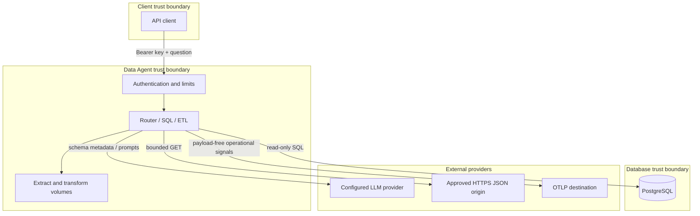
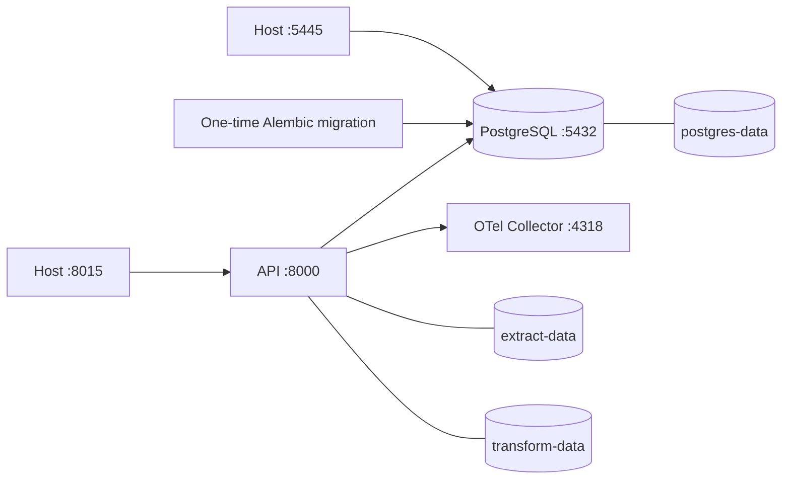

# Architecture

## 1. Architecture overview

Data Agent uses a layered, workflow-oriented architecture. FastAPI and the CLI
are delivery adapters; LangGraph coordinates the application workflows;
provider adapters, PostgreSQL, HTTPS APIs, and the filesystem are infrastructure
boundaries. Pydantic models define configuration and data contracts.

## 2. Architectural layers

| Layer | Responsibilities | Main implementation |
| --- | --- | --- |
| Delivery | HTTP/CLI input, authentication, throttling, response mapping, lifecycle | `api.py`, `cli.py` |
| Orchestration | Route work and control graph state transitions | `agents/` |
| Contracts | Validate workflow state, router output, reviews, and transformation plans | `agentschemas/`, `schemas/` |
| Domain/data model | Represent users, rides, vehicles, payments, and ratings | `models/` |
| Infrastructure | LLM selection, database access, SQL validation, extraction, files, telemetry | `utils/` |
| Deployment | Image, services, migrations, health ordering, volumes | `Dockerfile`, `compose.yaml`, `migrations/` |

Dependencies point inward toward contracts and configuration. Workflow modules
may call infrastructure utilities, while utilities do not import workflow
graphs.

## 3. System context and trust boundaries

Crossing a boundary requires explicit configuration and validation. API bearer
keys do not authorize LLM providers; provider keys do not authenticate API
clients. ETL bearer credentials are sent only to the exact configured HTTPS
origin.

## 4. Primary data flows

### SQL analysis

1. Validate and authenticate the API request.
2. Route the natural-language question to SQL.
3. Discover schema metadata and allowlisted categorical values without sample
   records.
4. Review answerability and ambiguity using structured LLM output.
5. Generate PostgreSQL SQL only for a clear question.
6. Apply deterministic read-only validation.
7. Apply an LLM relevance and categorical-literal review.
8. Reapply deterministic validation and execute in a read-only transaction.
9. Summarize the result and return the public workflow contract.

### ETL processing

1. Route the request to ETL.
2. Let the model select extraction or transformation using bound tools.
3. Validate all URLs, paths, formats, bounds, columns, and plan operations.
4. Execute the bounded operation.
5. Return the tool result to the model for a final response.

## 5. Deployment architecture

The local production-style topology consists of four Compose services:

PostgreSQL health gates migrations, and successful migration completion gates
the API. The API runs as UID/GID `10001`, has a container liveness probe, and
uses a stop grace period longer than the application drain timeout.

## 6. Quality attributes

### Security

- Production authentication cannot be disabled.
- Keys are hashed before comparison and limiter bucketing and compared in
  constant time.
- SQL has deterministic application checks plus a database read-only
  transaction.
- ETL prevents path traversal, overwrite, credential leakage, redirects, and
  cross-origin pagination.
- Images exclude local environment files and run without root privileges.

### Reliability

- LLM, SQL, readiness, and HTTP operations have timeouts.
- Retry counts and extracted pages/rows are bounded.
- Migrations run once before API startup.
- Graceful shutdown stops readiness, drains active work, and flushes telemetry.

### Observability

- A `run_id` correlates API requests and nested workflow runs.
- Structured logs record node start, completion, failure, status, and duration.
- OpenTelemetry exports HTTP spans and bounded operation metrics.
- Sensitive payloads are deliberately excluded from custom telemetry.

### Maintainability and portability

- Provider selection is isolated behind adapter registration.
- Pydantic schemas make LLM/tool outputs explicit.
- Alembic is the only production schema-change mechanism.
- Frozen dependencies, automated tests, packaging checks, Compose validation,
  and image builds run in CI.

## 7. Architecture decisions

| Decision | Rationale | Consequence |
| --- | --- | --- |
| LangGraph workflows | Explicit nodes and conditional transitions make agent behavior testable. | State contracts must remain backward compatible. |
| Preserve the original SQL question | Avoid semantic drift from an extra rewrite step. | Ambiguity is handled by review, not silent rewriting. |
| Deterministic SQL validation plus LLM review | Syntax safety and semantic relevance require different controls. | LLM approval alone never authorizes execution. |
| Allowlisted categorical discovery | Grounds common natural-language values without exposing arbitrary data. | New columns require an explicit configuration change. |
| Declarative ETL plans | Prevents generated-code execution. | Transformations are limited to the supported operation set. |
| Process-local throttling | Simple and dependency-free for one instance. | Shared limits require future external infrastructure. |
| OTLP through a collector | Keeps vendor coupling and credentials outside application code. | Production requires configuring a durable exporter. |
| Alembic startup gate | Prevents serving against an outdated schema. | Failed migrations prevent API startup by design. |

## 8. Known constraints

- Clarification is single-turn; callers resubmit the original question with the
  missing detail.
- The API has one query endpoint and no asynchronous job protocol.
- Rate and concurrency controls are not distributed.
- SQL correctness still depends partly on model behavior and database metadata.
- The supplied collector logs telemetry locally; it is not long-term storage.
