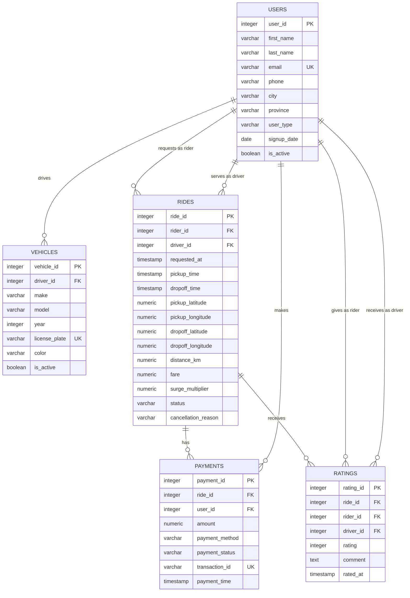

# Database design

## 1. Overview

Data Agent uses PostgreSQL and SQLAlchemy 2 declarative models. Application
tables live in the `public` schema. Alembic owns schema creation and seed-data
loading; application startup does not call `create_all`.

The current domain models a ride-sharing dataset with users acting as riders or
drivers, driver vehicles, rides, payments, and ratings.

## 2. Entity relationship model

## 3. Data dictionary

### `public.users`

| Column | Type | Null | Constraint/meaning |
| --- | --- | --- | --- |
| `user_id` | integer | No | Primary key |
| `first_name` | varchar(100) | No | User given name |
| `last_name` | varchar(100) | No | User family name |
| `email` | varchar(255) | No | Unique email address |
| `phone` | varchar(50) | Yes | Contact number |
| `city` | varchar(100) | Yes | City |
| `province` | varchar(50) | Yes | Province/state |
| `user_type` | varchar(20) | No | Rider/driver domain category |
| `signup_date` | date | Yes | Registration date |
| `is_active` | boolean | Yes | Activity flag |

### `public.vehicles`

| Column | Type | Null | Constraint/meaning |
| --- | --- | --- | --- |
| `vehicle_id` | integer | No | Primary key |
| `driver_id` | integer | No | Foreign key to `users.user_id` |
| `make` | varchar(50) | Yes | Manufacturer |
| `model` | varchar(50) | Yes | Model name |
| `year` | integer | Yes | Model year |
| `license_plate` | varchar(20) | Yes | Unique plate when non-null |
| `color` | varchar(30) | Yes | Vehicle color |
| `is_active` | boolean | Yes | Activity flag |

Index: `idx_vehicles_driver_id(driver_id)`.

### `public.rides`

| Column | Type | Null | Constraint/meaning |
| --- | --- | --- | --- |
| `ride_id` | integer | No | Primary key |
| `rider_id` | integer | No | Foreign key to `users.user_id` in the rider role |
| `driver_id` | integer | No | Foreign key to `users.user_id` in the driver role |
| `requested_at` | timestamp | Yes | Request timestamp |
| `pickup_time` | timestamp | Yes | Pickup timestamp |
| `dropoff_time` | timestamp | Yes | Drop-off timestamp |
| `pickup_latitude` | numeric(9,6) | Yes | Pickup latitude |
| `pickup_longitude` | numeric(9,6) | Yes | Pickup longitude |
| `dropoff_latitude` | numeric(9,6) | Yes | Drop-off latitude |
| `dropoff_longitude` | numeric(9,6) | Yes | Drop-off longitude |
| `distance_km` | numeric(10,2) | Yes | Distance in kilometres |
| `fare` | numeric(10,2) | Yes | Ride fare |
| `surge_multiplier` | numeric(4,2) | Yes | Applied surge factor |
| `status` | varchar(30) | Yes | Ride lifecycle category |
| `cancellation_reason` | varchar(100) | Yes | Cancellation category/detail |

Indexes: `idx_rides_rider_id`, `idx_rides_driver_id`,
`idx_rides_requested_at`, and `idx_rides_status`.

### `public.payments`

| Column | Type | Null | Constraint/meaning |
| --- | --- | --- | --- |
| `payment_id` | integer | No | Primary key |
| `ride_id` | integer | No | Foreign key to `rides.ride_id` |
| `user_id` | integer | No | Foreign key to `users.user_id` |
| `amount` | numeric(10,2) | Yes | Payment amount |
| `payment_method` | varchar(50) | Yes | Method category such as the stored `credit_card` literal |
| `payment_status` | varchar(30) | Yes | Payment lifecycle category |
| `transaction_id` | varchar(100) | Yes | Unique external transaction identifier when non-null |
| `payment_time` | timestamp | Yes | Payment timestamp |

Indexes: `idx_payments_ride_id` and `idx_payments_user_id`.

### `public.ratings`

| Column | Type | Null | Constraint/meaning |
| --- | --- | --- | --- |
| `rating_id` | integer | No | Primary key |
| `ride_id` | integer | No | Foreign key to `rides.ride_id` |
| `rider_id` | integer | No | Foreign key to `users.user_id` in the rating-author role |
| `driver_id` | integer | No | Foreign key to `users.user_id` in the rating-recipient role |
| `rating` | integer | Yes | Score constrained to 1 through 5 when non-null |
| `comment` | text | Yes | Free-text feedback; excluded from categorical grounding |
| `rated_at` | timestamp | Yes | Rating timestamp |

Constraint: `ck_ratings_chk_rating` enforces `rating BETWEEN 1 AND 5`.
Indexes: `idx_ratings_ride_id` and `idx_ratings_driver_id`.

## 4. ORM relationships

| Parent attribute | Related model | Relationship |
| --- | --- | --- |
| `User.vehicles` | `Vehicle.driver` | One driver to many vehicles |
| `User.rides_as_rider` | `Ride.rider` | One rider to many requested rides |
| `User.rides_as_driver` | `Ride.driver` | One driver to many served rides |
| `User.payments` | `Payment.user` | One user to many payments |
| `Ride.payments` | `Payment.ride` | One ride to many payment records |
| `User.ratings_given` | `Rating.rider` | One rider to many authored ratings |
| `User.ratings_received` | `Rating.driver` | One driver to many received ratings |
| `Ride.ratings` | `Rating.ride` | One ride to many rating records |

Role-specific `foreign_keys` declarations disambiguate the two user references
on rides and ratings.

## 5. Categorical grounding policy

The SQL workflow may retrieve bounded distinct values only for this configured
allowlist:

| Table | Columns |
| --- | --- |
| `payments` | `payment_method`, `payment_status` |
| `ratings` | `rating` |
| `rides` | `status`, `cancellation_reason` |
| `users` | `user_type`, `city`, `province`, `is_active` |
| `vehicles` | `make`, `model`, `color`, `is_active` |

The default maximum is 50 values per column. Identifiers must match the SQL
identifier pattern and may not repeat within a table. Sensitive or
high-cardinality fields—including names, email, phone, comments, IDs,
transaction IDs, and license plates—must not be added.

Allowed values are runtime metadata, not schema constraints. A value absent
from the bounded metadata must not automatically be treated as impossible.

## 6. Migration history

| Revision | Purpose |
| --- | --- |
| `c8e2638fcf8a` | Create the five public tables, foreign keys, constraints, and indexes |
| `a86b191887cf` | Load baseline CSV data for all tables |

Migrations resolve seed CSV files from the repository/container `data`
directory. Compose configures separate migration and read-only roles after
PostgreSQL becomes healthy, then runs `alembic upgrade head` before the API
starts.

## 7. Database roles

| Role | Compose setting | Capability |
| --- | --- | --- |
| Administrator | `POSTGRES_USER` | Initializes PostgreSQL and creates/updates the two restricted roles; not supplied to the API or migration job |
| Migration owner | `POSTGRES_MIGRATION_USER` | Owns `public`, tables, and sequences; has schema creation privileges and runs Alembic |
| Application reader | `POSTGRES_APP_USER` | Can connect, use `public`, and select current/future tables and sequences; defaults to read-only transactions |

The bootstrap job is idempotent and supports an existing volume by transferring
current public tables and sequences to the migration owner. Existing deployments
must retain the administrator username/password originally used to initialize
the volume. All role names and passwords must be distinct, long, and URL-safe
because Compose constructs database URLs from them.

## 8. Migration policy

- Use Alembic for every production schema change.
- Commit the ORM change, reviewed migration, tests, and this document together.
- Review autogenerated types, names, defaults, indexes, constraints, foreign
  keys, and any destructive operation.
- Back up irreplaceable data and test the migration on a staging copy.
- Run the lifecycle test only against a disposable database whose name contains
  `test`; its downgrade verification drops application tables.
- Do not change or delete an applied revision; add a new forward migration.

## 9. Access and safety recommendations

- Keep the administrator, migration, and application credentials in a secret
  manager outside local development.
- Audit role grants after schema migrations and retain automated negative tests
  proving that the application role cannot write.
- Keep PostgreSQL host port `5445` limited to trusted development machines; do
  not expose it publicly.
- Use TLS and managed secret injection outside the local Compose environment.
- Treat names, contact data, locations, comments, transaction identifiers, and
  exact coordinates as sensitive even though the application excludes them
  from custom telemetry and categorical grounding.
