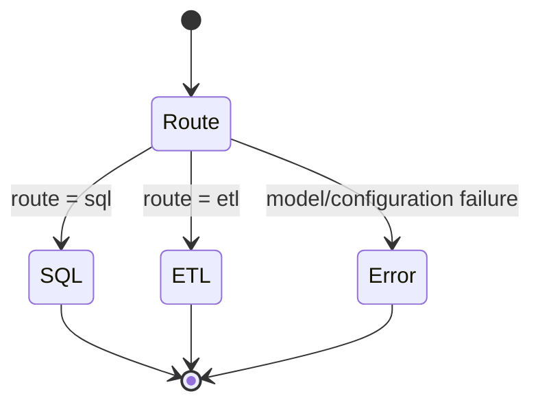
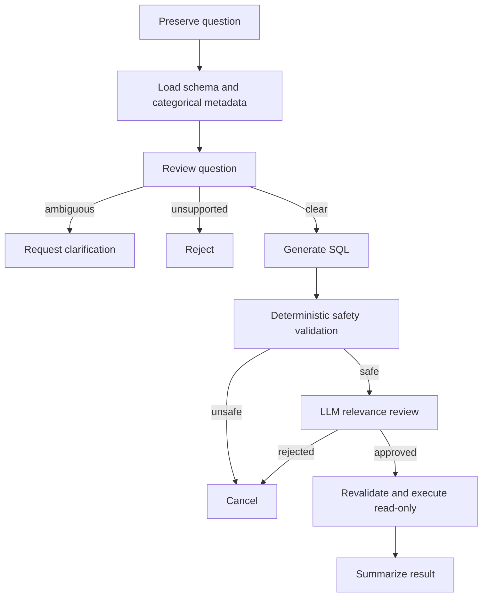
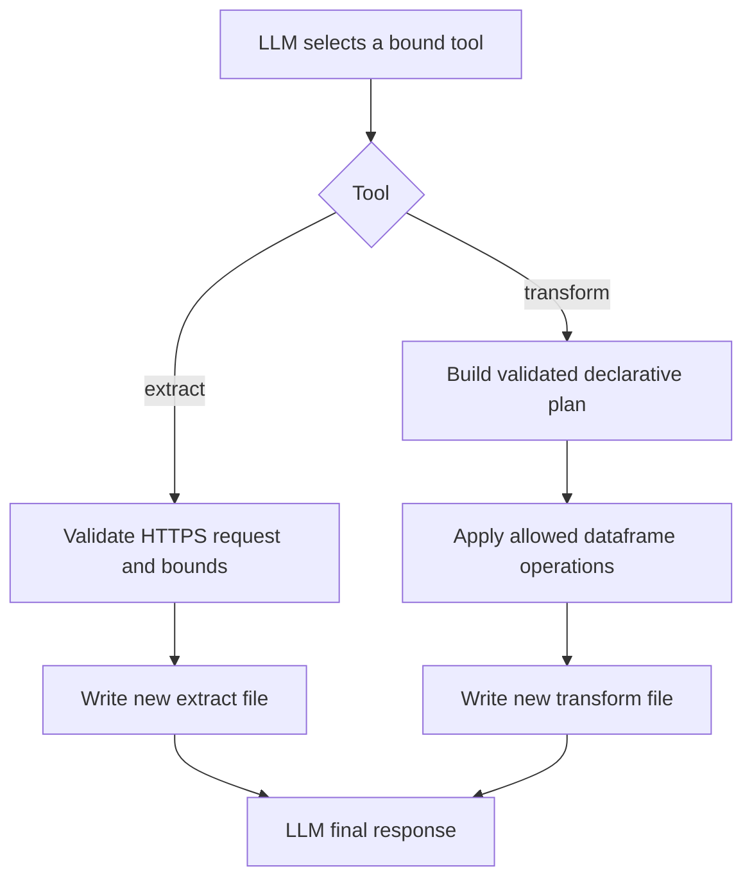

# High-level design

## 1. Purpose

This document defines the major runtime components, their responsibilities,
interfaces, and interactions. Implementation-level behavior is specified in
[LLD.md](LLD.md), while the relational schema is specified in
[DATABASE.md](DATABASE.md).

## 2. Component model

| Component | Input | Responsibility | Output |
| --- | --- | --- | --- |
| HTTP API | JSON question and optional bearer credentials | Validate requests, enforce security/limits, invoke workflow, map response | Versioned JSON response and request ID |
| CLI | Command-line question | Invoke the same router for one request | Final answer and process exit code |
| Router graph | Human message and run ID | Classify the request as SQL or ETL | Selected child workflow result |
| SQL graph | Database question | Validate intent, generate/review/execute read-only SQL, summarize | Answer, clarification, rejection, or safe error |
| ETL graph | Extraction/transformation request | Select and call bounded ETL tools | Operation result or safe error |
| LLM layer | Prompt, difficulty, structured schema/tools | Select provider/model and record safe usage telemetry | Model or structured response |
| Database layer | Schema request or approved SQL | Discover metadata and execute read-only work | Schema context or serialized rows |
| ETL layer | URL/path/format/plan | Fetch, normalize, transform, and persist bounded data | New file and row count |
| Observability layer | Operation lifecycle events | Emit structured logs, spans, and metrics | Correlated operational telemetry |

## 3. External interfaces

### HTTP

| Method and path | Authentication | Result |
| --- | --- | --- |
| `GET /health` | Public | Basic process status |
| `GET /health/live` | Public | Container liveness |
| `GET /health/ready` | Public | Traffic readiness and optional database check |
| `POST /api/v1/query` | Bearer key when enabled; mandatory in production | Routed workflow result |
| `GET /docs`, `/redoc`, `/openapi.json` | Public when explicitly enabled | Interactive/reference API documentation |

The request body contains `question`, a non-empty string of at most 4,000
characters. The response contains `run_id`, `status`, `route`, `final_answer`,
and `workflow_error`.

### Database

- Protocol: PostgreSQL through `asyncpg`.
- Application URL: `DATABASE_URL`, constructed with the read-only application
  role in Compose.
- Container endpoint: `postgres:5432`; local host endpoint: `localhost:5445`.
- Schema discovery: `information_schema` scoped to `DATABASE_SCHEMA`.
- Query execution: one read-only transaction with `SQL_TIMEOUT_SECONDS`.

### LLM providers

- Provider selection: `LLM_PROVIDER`.
- Built-in adapters: OpenAI and Anthropic.
- Work levels: low, medium, and high with provider-specific model IDs.
- Structured outputs: router, question review, SQL judge, and transformation
  plan.
- Provider access is outbound and may transmit question/schema/result context;
  deployment policy must account for that data boundary.

### ETL sources and storage

- Sources: HTTPS JSON endpoints only.
- Optional source authentication: bearer token restricted to an exact origin.
- Storage formats: CSV, newline-delimited JSON, and Parquet.
- Extraction destination: `data/extract`.
- Transformation inputs: beneath `data`; outputs: `data/transform`.

## 4. Workflow design

### Router

### SQL

### ETL

## 5. Security design

Security controls are layered:

1. Request size validation protects the HTTP boundary.
2. Bearer authentication identifies a configured API client.
3. Sliding-window rate limiting and concurrency limiting bound local load.
4. Structured LLM outputs constrain routing and review decisions.
5. Deterministic SQL rules authorize syntax; an LLM cannot override them.
6. PostgreSQL read-only transactions provide an execution-time backstop.
7. URL/origin rules and filesystem containment protect ETL boundaries.
8. Redacted operational telemetry avoids copying sensitive payloads.

## 6. Deployment and lifecycle

The container image uses a dependency builder and a minimal Python runtime. It
runs as a non-root user and contains application code, Alembic migrations, and
seed files. Compose provides:

- `postgres`: durable database with health checking and host port `5445`.
- `bootstrap-db-roles`: one-time idempotent creation/grant job using the
  administrator identity.
- `migrate`: one-time `alembic upgrade head` job using the schema-owner role.
- `otel-collector`: internal OTLP receiver with debug export.
- `api`: health-checked service on host port `8015` using the read-only role.

Startup order is PostgreSQL healthy → role bootstrap succeeds → migration
succeeds → API starts. Shutdown marks the API unready, waits for active
workflows up to the configured drain timeout, then closes telemetry.

## 7. Scalability model

The current design scales vertically or by adding API workers, subject to these
constraints:

- Each worker has independent rate-limit and concurrency state.
- Each SQL workflow creates and closes its own async connection pool.
- ETL processing is synchronous and uses local volumes.
- Requests remain open until workflow completion.

Horizontal production scale requires shared rate limiting, shared/durable ETL
storage, centralized telemetry, and an ingress/load-balancing layer.

## 8. Verification strategy

- Unit tests cover configuration, schemas, models, SQL validation, extraction,
  transformation, authentication, limiting, and observability.
- Workflow tests mock external providers and databases for deterministic offline
  behavior.
- Migration integration tests use a disposable PostgreSQL database.
- Container tests validate image structure and Compose semantics.
- CI enforces lint, format, at least 85% branch coverage, package build,
  Compose validation, and image build.
